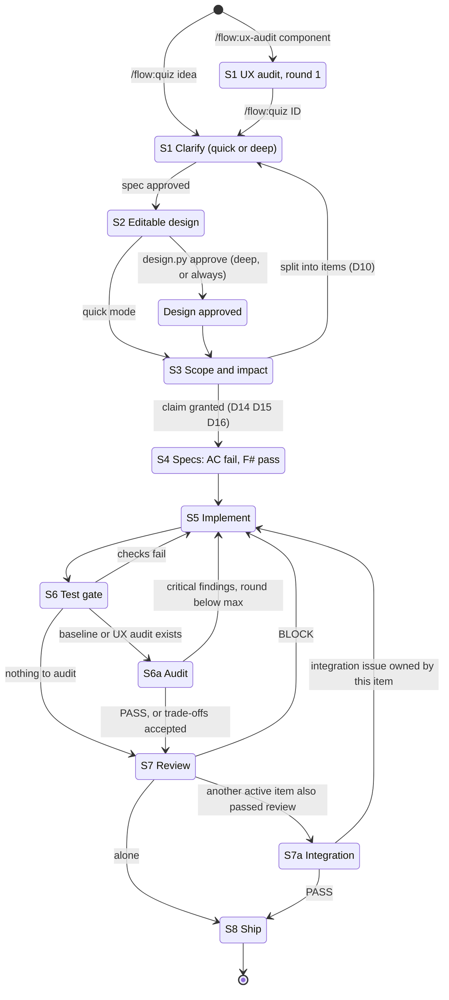
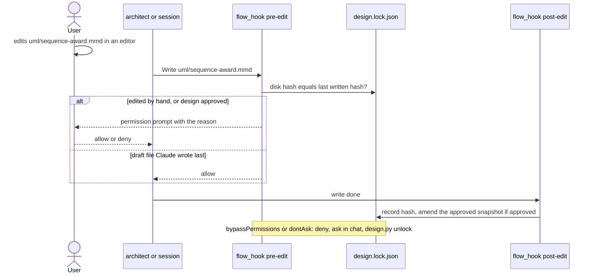
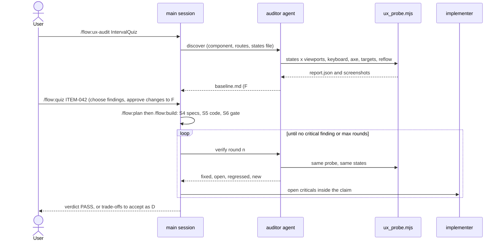
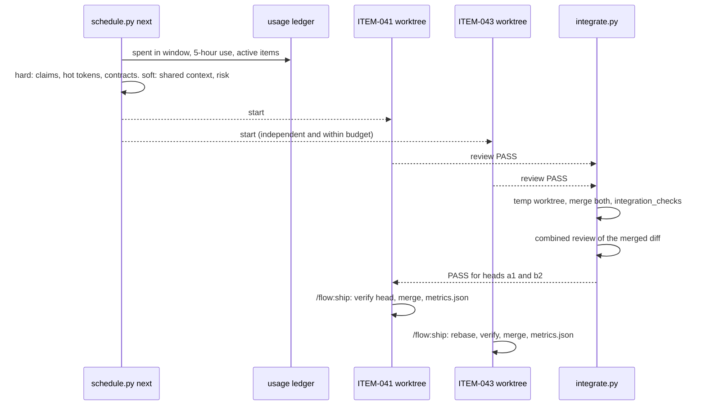

# Design: adaptive planning, UX audit and safe orchestration (v0.2)

Status: **preliminary, editable**. Change anything in this file, including the
diagrams; your edits win over the code, and the code and tests are brought in line
with them. Each decision (D#) is cited by the diagrams and by the acceptance criteria
(AC#) at the end, and each AC names the test that checks it.

## What is asked

| | Request | Where it lands |
|---|---|---|
| G1 | Deep clarification on or off; off means documented assumptions | `/flow:quiz`, config `deep_clarification` |
| G2 | Editable design before implementation; manual edits kept; approved changes authoritative; diagrams, contracts, tests and code in sync | `/flow:plan`, `design.lock.json`, hooks, `trace.py` |
| G3 | UX audit of one component, iterative, features preserved, stops at no critical issues or documented trade-offs | `/flow:ux-audit`, `auditor` agent, `ux_probe.mjs` |
| G4 | Highest reasoning effort for complex planning; complexity analysis only where it matters; split oversized work | `/flow:plan`, `performance.md`, budgets |
| G5 | Token-aware parallel work: contracts and context checked, global cost budget and concurrency limit, conservative without live data | `schedule.py`, status line usage ledger |
| G6 | Integration gate after parallel items; track tokens and rework for future scheduling | `/flow:integrate`, `integrate.py`, `metrics.json` |

Both new modes reuse the existing gated flow; nothing runs outside it.

## Decisions

| ID | Decision | Rejected | Why |
|----|----------|----------|-----|
| D1 | `deep_clarification: false` (boolean) in `.flow/config.json`; `--deep` / `--quick` per run; the spec records `clarify: quick \| deep` | a separate deep-quiz command | one quiz, one spec format |
| D2 | Quick mode asks only the high-impact slots; every other slot becomes an assumption A# with "if wrong"; the approval question offers deep mode when 3 or more high-impact assumptions remain | asking every slot | quick means fewer questions, not hidden guesses |
| D3 | Deep mode keeps a question ledger (open, answered as D#, assumed as A#), asks 1-2 per round highest impact first, never re-asks a closed slot, ends when no high-impact question is open and every AC is testable, then needs an explicit "Approve" | a fixed question count | ends on clarity, not on a number |
| D4 | Design files: `uml/*.mmd`, `data-structures.md`, `messages.md`, `performance.md`, `baseline.md`. `design.lock.json` holds the hash of the last content Claude wrote to each and the approved snapshot | git history alone | a hook needs a fast, local answer to "did a person change this?" |
| D5 | A Claude edit to a design file that was edited by hand, or to an approved design, gets `permissionDecision: "ask"` (it prompts in auto mode too). In `bypassPermissions` and `dontAsk` the hook denies and Claude asks in chat, then runs `design.py unlock`. After an edit the hook records the hash; an approved design stays approved because the edit went through the prompt | blocking outright | the user decides per edit, and sees the diff |
| D6 | Design approval (`design.py approve`) is required before code edits when `clarify: deep`, or always with `design_approval: "always"` | approval for every item | quick items keep today's speed |
| D7 | `trace.py check` keeps spec, design, baseline, budgets and tests in sync and lists diagram participants it cannot find in the code; the architect and reviewer confirm drift with the graph | a graph-only check | the script runs without Graphify and in CI |
| D8 | `performance.md`: per path the runs, data size, latency budget and memory; complexity analysis only when a threshold is crossed; budgets PB# with a metric, a number and a test | Big-O for every structure | tokens go where the workload is |
| D9 | Planning (design, impact, re-plan, integration review) runs at effort `max` when the item is complex (deep budget, security blockers, an `api:` or `schema:` contract change, more than 2 domains or about 25 nodes); otherwise at the budget's `planning.effort`. Claude Code falls back to the highest level the model supports | max effort everywhere | effort costs tokens on every turn |
| D10 | Plan proposes a split when the impact set passes `split_at` (40 nodes or 3 domains) | building it as one item | smaller claims run in parallel and review faster |
| D11 | `baseline.md` lists what the touched components do today (F#) with their tests and a plan per row: keep, change (D#) or remove (D#). S4 writes characterization specs for untested keep rows; the Stop hook runs `baseline_check` on the listed test files | relying on the full suite | the full suite may not cover the component |
| D12 | New stage S6a Audit, run at the end of `/flow:build` by the `auditor` agent when the item has a baseline or a UX audit. It writes `audit.md` with a verdict. After `ux_audit.max_rounds` rounds (3) the remaining findings need the user's acceptance as D# rows | a separate audit pipeline | same gates, same files |
| D13 | `/flow:ux-audit <component>` is the S1 entry for UX work: baseline (F#), interaction map, state matrix, probe evidence, findings U# with severity 0-4, proposals. `/flow:quiz <ID>` then picks the findings to fix. `/flow:ux-audit <ID>` re-audits | auditing the whole app | the request is one component at a time |
| D14 | `impact.json` gains `contracts: {changes, uses}` (`api:`, `schema:`, `bus:`, `config:`, `state:`, `ui:`). A change that meets the other item's change or use is a hard conflict; `waves` puts the user after the changer | file overlap only | two items can break each other without sharing a file |
| D15 | Soft blockers: shared read context of 50% or more of the smaller item's nodes, or both items `risk: high` in one domain. `next` and `waves` run such items one after the other | always parallel when files differ | duplicated reading and rework cost more than waiting |
| D16 | Capacity: `orchestration.cost_budget_usd` per `budget_window`, a 5-hour rate-limit floor, `wip_limit` as the hard concurrency cap. Usage comes from a ledger the status line writes; without it each active item counts at 1.5 times its estimate. Estimates are the median shipped cost per budget level (3 or more items), else `budgets.<level>.estimate_usd`. `claim` refuses past a hard limit unless the user passes `--force` | live API calls | no extra dependency; the status line already receives the numbers |
| D17 | New stage S7a Integration: when two or more active items have a review PASS, `/flow:integrate` test-merges them in a temporary worktree, runs `integration_checks` and a combined review. `/flow:ship` refuses until the item's HEAD is in a PASS run | trusting sequential rebases only | finished items are checked together before either merges |
| D18 | `/flow:ship` writes `docs/items/<ID>/metrics.json`: cost, sessions, gate failures, rework rounds (from commit subjects), escalations, parallel partners | a shared metrics file | one file per item never conflicts |
| D19 | Stage IDs S1-S8 stay (the security registry keys on them); the new stages are S6a and S7a | renumbering | existing projects keep their checklists |

## Pipeline

## Editable design guard

Re-planning (`/flow:plan <ID>` again) starts with `design.py status` and `trace.py check
--stage plan`. Files edited by hand are inputs: the architect reads them, changes the
ACs, messages and tests to match (the user approves AC changes), and never regenerates
them. Drift between diagrams and code is listed with the side that moved, and the user
picks which side wins.

## UX audit loop

Severity follows Nielsen's 0-4 scale. Critical (4) and major (3) findings in the
chosen scope must be fixed or accepted by the user. A WCAG 2.2 level A or AA failure on
the component's main task is at least major (3).

## Parallel waves and the integration gate

## Data structures

| File | Holds | Written by |
|---|---|---|
| `docs/items/<ID>/design.lock.json` | `{"files": {path: sha256}, "approved": {"at", "files": {path: sha256}} \| null}` | hooks, `design.py` |
| `docs/items/<ID>/baseline.md` | F# table: feature, where, tests, plan | architect or auditor, the user edits |
| `docs/items/<ID>/performance.md` | workload table, analysis for marked rows, PB# budgets | architect |
| `docs/items/<ID>/audit.md` | frontmatter `kind`, `round`, `verdict`; interaction map, state matrix, U# findings, rounds, trade-offs | auditor |
| `docs/items/<ID>/impact.json` | adds `contracts`, `risk` | architect or session |
| `<git-common-dir>/flow-usage/<session>.json` | session, item, cost, 5-hour and 7-day use, updated | status line |
| `<git-common-dir>/flow-integration/<run>.json` | items and heads, checks, review verdict | `integrate.py` |
| `docs/items/<ID>/metrics.json` | cost, sessions, rework, escalations, parallel partners | `schedule.py record` |

Hashes are taken over the text with line endings normalized, so a Windows checkout
does not look like a manual edit.

Workload (D8 applied to this change): the pre-edit hook runs on every edit and hashes
at most about ten small design files (well under 10 ms); the status line runs on
every event, debounced at 300 ms, and writes its ledger file only when a value
changes; the scheduler compares pairs of at most a few dozen items on demand. None of
these needs more analysis.

## Acceptance criteria

Tests are in `tests/test_workflow.py`; each line names the check that covers it.

- AC1 (D4, D5): an edit to a design file changed by hand gets `ask`; an edit to a draft
  file Claude wrote last is allowed. Test: "design guard: hand edit asks".
- AC2 (D5): once approved, any design edit gets `ask`; in `bypassPermissions` it is
  denied. Test: "design guard: approved design asks", "design guard: bypass denies".
- AC3 (D5): post-edit records the hash, and an approved design stays approved after an
  edit through the prompt. Test: "design post-edit keeps approval".
- AC4 (D6): with `clarify: deep`, code edits on the item branch are blocked until the
  design is approved. Test: "design gate: code edit waits for approval".
- AC5 (D7, D11): `trace.py` reports an unknown D#, an AC without a test, a test for an
  unknown AC, a change row without a D#, open questions in deep mode, and a diagram
  participant missing from the code. Test: "trace: ..." checks.
- AC6 (D11): the Stop hook runs `baseline_check` with the baseline's test files. Test:
  "stop: baseline tests run".
- AC7 (D14): `claim` refuses a contract conflict with an active item; `waves` puts the
  user after the changer. Test: "contracts: ...".
- AC8 (D15): `next` serializes items that share most of their nodes. Test: "next:
  shared context serializes".
- AC9 (D16): `next` starts only what the remaining budget covers, and estimates
  conservatively without usage data. Test: "capacity: ...".
- AC10 (D16): the status line writes the usage ledger. Test: "status line: usage
  ledger".
- AC11 (D17): `integrate.py run` merges two reviewed items and runs the checks;
  `verify` passes for those heads and fails after a new commit. Test: "integrate: ...".
- AC12 (D13): `ux_probe.mjs` reports tab order, small targets, horizontal overflow at
  320 px and unnamed controls on a fixture page. Test: "ux probe: ..." (needs Node and
  Playwright).
- AC13 (D12, D17, D19): stage guesses include S2 waiting for approval, S6a and S7a.
  Test: "stage: ...".
- AC14: every skill and agent names only files the plugin ships. Test: existing check.

## Out of scope

- Live calls to the Anthropic usage API; the ledger uses what the status line receives.
- Market comparison by web research during an audit, unless the user asks for it.
- Renumbering stages or changing the security registry.
